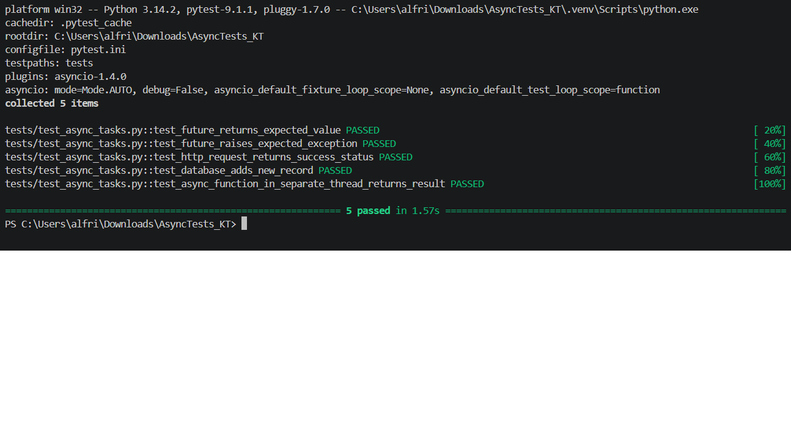

# Асинхронные тесты (AsyncTests_KT)

**Задание:** решение 5 задач на асинхронность.

## Используемые технологии

- Python
- Pytest
- pytest-asyncio
- aiohttp
- aiosqlite
- asyncio

## Реализованные тесты

1. Проверка возврата ожидаемого значения Future.
2. Проверка ожидаемого исключения Future.
3. Проверка HTTP-запроса к внешнему API.
4. Проверка добавления записи в SQLite.
5. Проверка запуска асинхронной функции в отдельном потоке.

## Результат тестирования

Все 5 тестов пройдены успешно.

